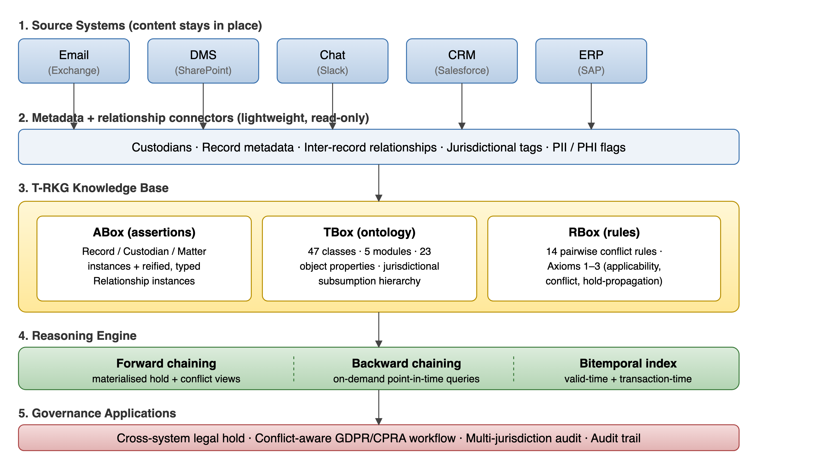
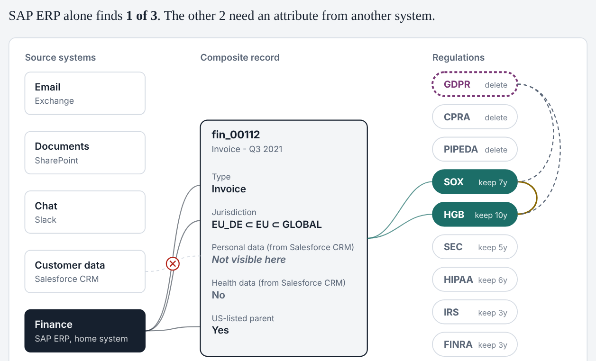
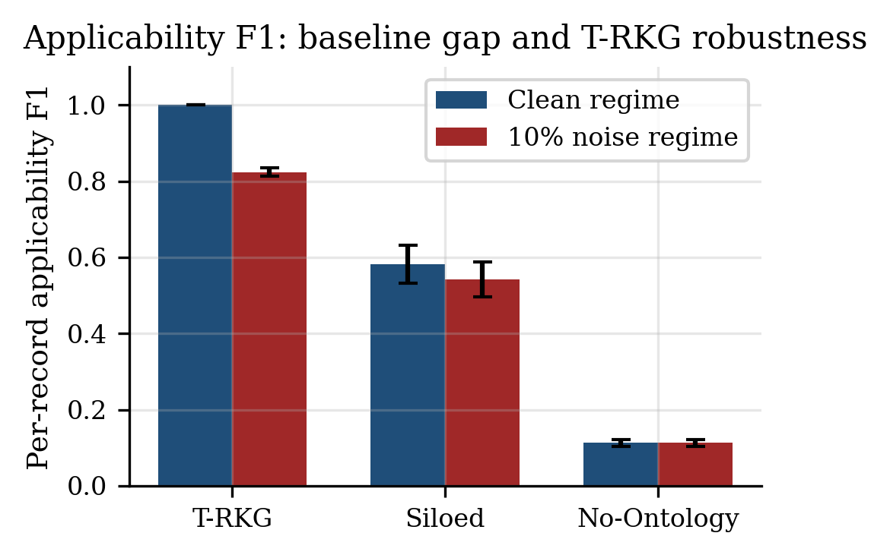

# T-RKG: Temporal Records Knowledge Graph

**Find regulatory conflicts that no single enterprise system can see.**

[](https://ieeexplore.ieee.org/document/11675805)
[](https://doi.org/10.1109/ACCESS.2026.3729794)
[](https://www.python.org/)
[](https://creativecommons.org/licenses/by/4.0/)

T-RKG is a knowledge-based system that detects conflicts between regulations (GDPR, SOX, HIPAA, SEC, CPRA, PIPEDA, IRS, HGB, FINRA) on the same enterprise record — even when the attributes that trigger each regulation live in different source systems. It is the reference implementation for our *IEEE Access* paper.

<p align="center">
  
</p>

## Try it in your browser

**[Open the T-RKG Explorer](https://kpulagam.github.io/T-RKG/)**. Pick a real record from the synthetic corpus, or edit its attributes, and see which regulations apply and where they conflict. Switch to **Siloed** to see what each source system finds on its own, then place a legal hold and watch it spread through attachments, threads, derivations, and references. The page uses the same rules as `trkg/conflict.py` and was checked against the Python code on all 10,000 records of the seed-42 corpus.

<p align="center">
  <a href="https://kpulagam.github.io/T-RKG/"></a>
</p>

## The problem

Records governance is split across systems. Email enforces communication retention, the ERP enforces financial rules, the privacy platform enforces erasure, and none of them sees the others' logic.

Take one invoice from a German subsidiary of a US-listed company:

| Attribute | Lives in | Triggers |
|---|---|---|
| Contains personal data | Customer-data / privacy system | **GDPR** — delete on erasure request |
| Parent is a public company | Organizational metadata | **SOX** — retain for 7 years |
| Jurisdiction = Germany | Compliance system | **HGB** — German commercial retention |

GDPR says *delete*, SOX and HGB say *keep*. The conflict is real, but it exists only in the **combination** of attributes. No single system holds all three, so no single system can see it.

T-RKG models each record as a composite of the attributes it collects across systems, reasons over which regulations apply, and reports every contradictory pair with a type and severity.

## What's inside

- **Governance ontology** — 47 domain classes, 23 object properties, and a 6-class temporal-relationship module (53 OWL classes), in [`ontology/trkg.ttl`](ontology/trkg.ttl)
- **Applicability reasoning** — jurisdiction subsumption (e.g. `EU_DE → EU → GLOBAL`) plus record-type and attribute conditions per regulation
- **Conflict detection** — pairwise rules for retention-deletion, jurisdiction, hold-deletion, and priority conflicts, including a defeasibility axiom for **GDPR Art. 17(3)** exemptions
- **Typed hold propagation** — legal holds follow relationships based on their declared semantics (attachments propagate; passing references do not), with per-matter overrides
- **Baselines** — Siloed, No-Ontology, SHACL Core, SHACL-SPARQL, flat-list, SQLite recursive CTE, and an LLM baseline, all under [`trkg/baselines/`](trkg/baselines)

## Quickstart

```bash
git clone https://github.com/kpulagam/T-RKG.git
cd T-RKG
pip install -r requirements.txt
```

Generate a synthetic corpus and detect conflicts. This needs no API key and no external data:

```python
from trkg import generate_test_dataset, ConflictDetector

store = generate_test_dataset(num_records=10_000, seed=42)
detector = ConflictDetector()

# The worked example from the paper (Section V-D)
record = store.records["fin_00112"]
print(sorted(r.value for r in detector.infer_applicable_regulations(record)))
for c in detector.detect_conflicts_for_record(record):
    print(c.regulation_a.value, "-", c.regulation_b.value, c.conflict_type.value, c.severity.value)

# Whole corpus
result = detector.detect_all_conflicts(store.records)
print(result.total_conflicts, "conflicts across", result.total_records_analyzed, "records")
```

Output for the example record:

```
['GDPR', 'HGB', 'SOX']
GDPR - HGB RETENTION_DELETION HIGH
GDPR - SOX RETENTION_DELETION CRITICAL
SOX - HGB PRIORITY MEDIUM
```

## Key results

Ten random seeds, synthetic corpora from 1K to 100K records. Full details are in the paper.

<p align="center">
  
</p>

| Result | T-RKG | Comparison |
|---|---|---|
| Applicability F1 under 10% label noise | **0.826 ± 0.011** | Siloed 0.604 ± 0.035 · No-Ontology 0.141 ± 0.011 |
| Conflicts found vs. SHACL Core (100K records) | **100%** | SHACL Core finds ~4%, and takes ~62× longer |
| Cross-domain conflicts detected | **7 – 994** per dataset | Attribute-blind baselines: 0 (proved by Corollary 1) |
| Hold-set expansion (Conservative policy) | **3.07×** over direct seeds | — |
| Hold-propagation speed | — | ~39× faster than flat-list, ~175× faster than SQLite recursive CTE |

Clean-regime F1 is 1.000 by construction. The noised regime is the real accuracy test.

## Reproduce the paper

```bash
pip install -r requirements.txt rdflib pyshacl pytest
python -m experiments.run_all          # writes experiments/results.json (about 1–3 minutes)
python -m pytest tests/                # unit tests
```

- [`experiments/MANIFEST.md`](experiments/MANIFEST.md) — every table regenerated in one run, with internal consistency checks
- [`EXPERIMENTS_SUMMARY.md`](EXPERIMENTS_SUMMARY.md) — status of the follow-up experiments (E1–E6)
- [`experiments/results/`](experiments/results) — write-ups for E1, E3, E5, E6

**E1 (LLM applicability baseline)** calls a real model (`claude-opus-4-7`) and **needs an `ANTHROPIC_API_KEY`**, so it is not reproducible from committed data alone. It replays from the local on-disk cache (`experiments/cache/llm/`, untracked) when present, so a re-run costs nothing if the cache is intact. Without the cache it spends on the API again, and with neither key nor cache it reports `status="BLOCKED"` instead of making up metrics.

```bash
pip install anthropic
export ANTHROPIC_API_KEY=sk-...
python experiments/e1_llm_baseline.py
```

## Repository layout

```
trkg/            core library: schema, graph store, synthetic generator, conflict detector
trkg/baselines/  Siloed, No-Ontology, SHACL, SHACL-SPARQL, flat-list, SQL, LLM baselines
ontology/        OWL/Turtle governance ontology (trkg.ttl)
experiments/     run_all.py and the E1–E6 experiment scripts, results, labeling kit
figures/         paper figures and make_figures.py
docs/            T-RKG Explorer, the interactive page served by GitHub Pages
tests/           unit tests
```

## Limitations

All evaluation uses synthetic data from a seeded generator. Results show what the reasoning can do on that data. They are not a measurement on a production corpus. See Section VIII-E of the paper.

## Citation

> K. Pulagam and S. Sakalam, "T-RKG: A Knowledge-Based System for Cross-System Regulatory Conflict Detection in Enterprise Records Governance," *IEEE Access*, vol. 14, pp. 138420–138439, 2026, doi: [10.1109/ACCESS.2026.3729794](https://doi.org/10.1109/ACCESS.2026.3729794).

Open access under [CC BY 4.0](https://creativecommons.org/licenses/by/4.0/). Read it on [IEEE Xplore](https://ieeexplore.ieee.org/document/11675805).

```bibtex
@article{pulagam2026trkg,
  author  = {Pulagam, Kishore and Sakalam, Sai},
  journal = {IEEE Access},
  title   = {{T-RKG}: A Knowledge-Based System for Cross-System Regulatory Conflict Detection in Enterprise Records Governance},
  year    = {2026},
  volume  = {14},
  pages   = {138420-138439},
  doi     = {10.1109/ACCESS.2026.3729794}
}
```

GitHub's **"Cite this repository"** button (from [`CITATION.cff`](CITATION.cff)) gives the same citation.

## Authors

- **Kishore Pulagam** — Northwestern University; PayPal Data Services
- **Sai Sakalam** — Independent Researcher

Questions and issues are welcome via [GitHub Issues](https://github.com/kpulagam/T-RKG/issues).
